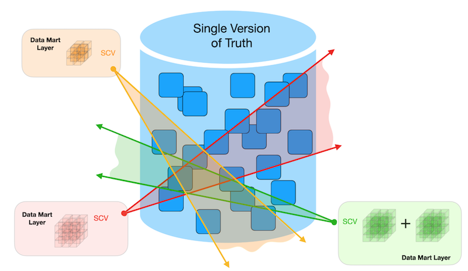
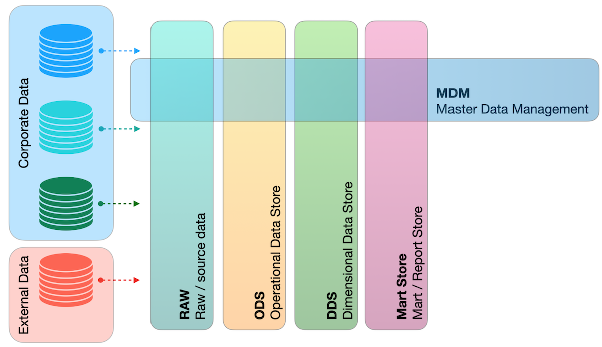
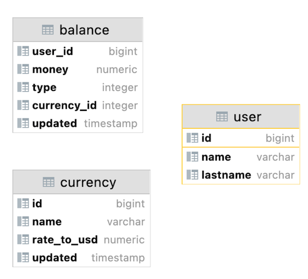
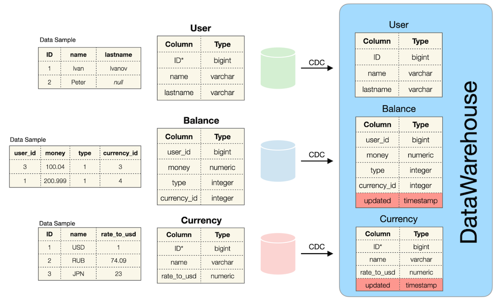
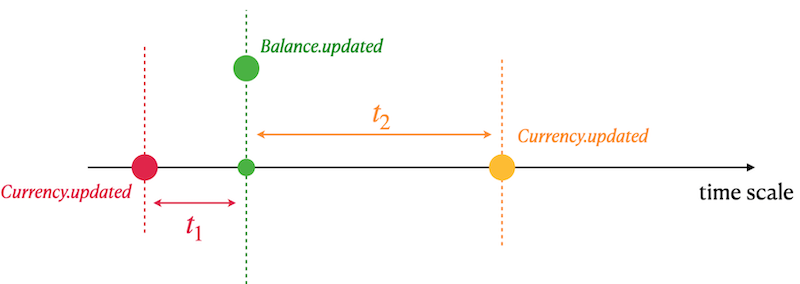

# Team 01 — SQL Bootcamp

## _Хранилище данных (Data Warehouse)_

Резюме: Сегодня вы узнаете, что такое DWH (Data Warehouse — хранилище данных) и как создать первый ETL-процесс (Extract, Transform, Load — извлечение, преобразование, загрузка).

💡 [Нажмите сюда](https://new.oprosso.net/p/4cb31ec3f47a4596bc758ea1861fb624), **чтобы оставить отзыв о проекте**. Это анонимно и поможет нашей команде улучшить ваш образовательный опыт. Мы рекомендуем заполнить опрос сразу после завершения проекта.

## Содержание

1. [Глава I](#глава-i) \
    1.1. [Преамбула](#преамбула)
2. [Глава II](#глава-ii) \
    2.1. [Общие правила](#общие-правила)
3. [Глава III](#глава-iii) \
    3.1. [Правила дня](#правила-дня)
4. [Глава IV](#глава-iv) \
    4.1. [Упражнение 00 — Классическое DWH](#упражнение-00--классическое-dwh)
5. [Глава V](#глава-v) \
    5.1. [Упражнение 01 — Детальный запрос](#упражнение-01--детальный-запрос)

## Глава I
## Преамбула

DWH (Data Warehousing — процесс построения хранилища данных) — это процесс сбора и управления данными из разнородных источников для получения значимых бизнес-выводов. Хранилище данных обычно используется для объединения и анализа бизнес-данных из гетерогенных (разнотипных) источников. Хранилище данных — это ядро BI-системы (Business Intelligence — бизнес-аналитика), предназначенной для анализа данных и формирования отчётов.

Существуют 2 «отца» DWH с противоположными взглядами на то, как лучше строить хранилище данных с точки зрения логических слоёв данных.

|  |  |
| ------ | ------ |
| «DWH — это предметно-ориентированная, интегрированная, неизменяемая и изменяющаяся во времени коллекция данных для поддержки управленческих решений.» (Билл Инмон / Bill Inmon) |  |
|  | «DWH — это система, которая извлекает, очищает, приводит к единому виду и доставляет исходные данные в многомерное хранилище, а затем поддерживает и реализует запросы и анализ для принятия решений.» (Ральф Кимбалл / Ralph Kimball) |

В наши дни объёмы Big Data (больших данных) постоянно растут, и нам нужно всё больше ресурсов для контроля, структурирования и дальнейшего исследования данных. Для поддержки классических систем DWH появился новый паттерн (шаблон проектирования) под названием LakeHouse (основанный на λ-архитектуре, то есть лямбда-архитектуре) = DataLake (озеро данных — хранилище сырых, необработанных данных) + DataWareHouse (структурированное хранилище). С логической точки зрения современный LakeHouse можно представить как набор логических слоёв данных.

Поэтому, чтобы быть Архитектором данных (Data Architect), нужно знать «чуть больше», чем реляционное моделирование.
Рассмотрим список существующих паттернов моделей данных:
- Реляционная модель (Relational Model),
- Темпоральная модель (Temporal Model — модель с хранением истории изменений),
- Битемпоральная модель (BiTemporal Model — модель с двумя временными осями: время события и время записи),
- USS-модель (Unified Star Schema — унифицированная звёздная схема),
- EAV-модель (Entity-Attribute-Value — «Сущность-Атрибут-Значение»),
- Модели «Звезда» / «Снежинка» (Star / Snowflake),
- Модель «Галактика» (Galaxy Model),
- Data Vault модель (хранилище данных на основе хабов, линков и сателлитов),
- Якорная модель (Anchor Model),
- Графовая модель (Graph Model).

## Глава II
## Общие правила

- Используйте эту страницу как единственный источник информации. Не слушайте слухи и домыслы о том, как готовить решение.
- Убедитесь, что вы используете последнюю версию PostgreSQL.
- Вполне допустимо использовать IDE (Integrated Development Environment — интегрированную среду разработки) для написания исходного кода (то есть SQL-скриптов).
- Для оценки ваше решение должно находиться в вашем GIT-репозитории.
- Ваши решения будут оцениваться вашими коллегами (peer-review — взаимная проверка).
- В вашей директории не должно быть никаких файлов, кроме тех, которые явно указаны в инструкциях к упражнению. Рекомендуется настроить `.gitignore`, чтобы избежать случайностей.
- Есть вопрос? Спросите соседа справа. Если не помогло — попробуйте соседа слева.
- Ваш справочник: коллеги / Интернет / Google.
- Внимательно читайте примеры. Вам могут понадобиться вещи, не указанные в теме напрямую.
- Да пребудет с вами SQL-Сила!
На SQL можно выразить абсолютно всё! Давайте начнём и получим удовольствие!

## Глава III
## Правила дня

- Убедитесь, что у вас есть собственная база данных и доступ к ней на вашем кластере PostgreSQL.
- Все задания содержат разделы «Разрешено» (Allowed) и «Запрещено» (Denied) с перечислением допустимых параметров базы данных, типов, SQL-конструкций и т.д. Ознакомьтесь с этими разделами перед началом работы.
- Скачайте [скрипт](materials/rush01_model.sql) с моделью базы данных и примените его к своей базе (можно использовать командную строку с psql или запустить через любую IDE, например DataGrip от JetBrains или pgAdmin от сообщества PostgreSQL).
- Ознакомьтесь с логическим представлением нашей модели базы данных.

## Глава IV
## Упражнение 00 — Классическое DWH

| Упражнение 00: Классическое DWH |                                                                                                                          |
|---------------------------------------|--------------------------------------------------------------------------------------------------------------------------|
| Директория сдачи                      | ex00                                                                                                                     |
| Файлы для сдачи                       | `team01_ex00.sql`                                                                           |
| **Разрешено**                             |                                                                                                                          |
| Язык                            |  SQL|

Рассмотрим источники данных и первый логический слой данных (ODS — Operational Data Store, то есть оперативное хранилище данных) в DWH.

Определение таблицы `User` (в Зелёной исходной базе данных):

| Имя столбца | Описание |
| ------ | ------ |
| ID | Первичный ключ (Primary Key) |
| name | Имя пользователя |
| lastname | Фамилия пользователя |

Определение таблицы `Currency` (в Красной исходной базе данных):

| Имя столбца | Описание |
| ------ | ------ |
| ID | Первичный ключ (Primary Key) |
| name | Название валюты |
| rate_to_usd | Курс по отношению к валюте USD (доллар США) |

Определение таблицы `Balance` (в Синей исходной базе данных):

| Имя столбца | Описание |
| ------ | ------ |
| user_id | «Виртуальный внешний ключ» (Virtual Foreign Key) к таблице User из другого источника |
| money | Сумма денег |
| type | Тип баланса (может быть 0, 1, ...) |
| currency_id | «Виртуальный внешний ключ» (Virtual Foreign Key) к таблице Currency из другого источника |

Зелёная, Красная и Синяя базы данных — это независимые источники данных, соответствующие микросервисному паттерну (microservice pattern — архитектурный шаблон, где каждый сервис имеет свою базу данных). Это означает высокий риск аномалий данных (см. ниже).
- Таблицы не находятся в состоянии согласованности данных (data consistency). Это значит, что может существовать пользователь (User), но без строк в таблице Balance, или наоборот — есть запись в Balance, но нет соответствующего пользователя в User. Аналогичная ситуация между таблицами Currency и Balance. (Другими словами, между ними нет явных внешних ключей — foreign keys).
- Возможны NULL-значения (пустые значения) для полей Name и Lastname в таблице User.
- Все таблицы работают в режиме OLTP (OnLine Transactional Processing — оперативная обработка транзакций) SQL-трафика. Это означает, что хранится только текущее состояние данных на момент времени, исторические изменения для каждой таблицы не сохраняются.

Эти 3 перечисленные таблицы являются источниками данных для таблиц с аналогичными моделями данных в области DWH.

Определение таблицы `User` (в базе данных DWH):

| Имя столбца | Описание |
| ------ | ------ |
| ID | Первичный ключ (Primary Key) |
| name | Имя пользователя |
| lastname | Фамилия пользователя |

Определение таблицы `Currency` (в базе данных DWH):

| Имя столбца | Описание |
| ------ | ------ |
| ID | Мнимый первичный ключ (Mocked Primary Key) |
| name | Название валюты |
| rate_to_usd | Курс по отношению к валюте USD |
| updated | Временна́я метка (timestamp) события из исходной базы данных |

`Мнимый первичный ключ` (Mocked Primary Key) означает, что существуют дубликаты с одинаковым ID, потому что добавлен новый атрибут `updated`, который преобразует нашу Реляционную модель в Темпоральную реляционную модель (Temporal Relational Model — модель, хранящую историю изменений во времени).

Рассмотрим пример данных для валюты «EUR» (евро) ниже.
Этот пример основан на SQL-запросе:

    SELECT *
    FROM Currency
    WHERE name = 'EUR'
    ORDER BY updated DESC;

| ID | name | rate_to_usd | updated |
| ------ | ------ | ------ | ------ |
| 100 | EUR | 0.9 | 03.03.2022 13:31 |
| 100 | EUR | 0.89 | 02.03.2022 12:31 |
| 100 | EUR | 0.87 | 02.03.2022 08:00 |
| 100 | EUR | 0.9 | 01.03.2022 15:36 |
| ... | ... | ... | ... |

Определение таблицы `Balance` (в базе данных DWH):

| Имя столбца | Описание |
| ------ | ------ |
| user_id | «Виртуальный внешний ключ» к таблице User из другого источника |
| money | Сумма денег |
| type | Тип баланса (может быть 0, 1, ...) |
| currency_id | «Виртуальный внешний ключ» к таблице Currency из другого источника |
| updated | Временна́я метка (timestamp) события из исходной базы данных |

Рассмотрим пример данных.
Этот пример основан на SQL-запросе:

    SELECT *
    FROM Balance
    WHERE user_id = 103
    ORDER BY type, updated DESC;

| user_id | money | type | currency_id | updated |
| ------ | ------ | ------ | ------ | ------ |
| 103 | 200 | 0 | 100 | 03.03.2022 12:31 |
| 103 | 150 | 0 | 100 | 02.03.2022 11:29 |
| 103 | 15 | 0 | 100 | 03.03.2022 08:00 |
| 103 | -100 | 1 | 102 | 01.03.2022 15:36 |
| 103 | 2000 | 1 | 102 | 12.12.2021 15:36 |
| ... | ... | ... | ... |... |

Все таблицы в DWH наследуют все аномалии из исходных таблиц.
- Таблицы не находятся в состоянии согласованности данных.
- Возможны NULL-значения для полей Name и Lastname в таблице User.

Напишите SQL-запрос, который возвращает общий объём (сумму всех денежных средств) транзакций из баланса пользователя, агрегированный по пользователю и типу баланса. Обратите внимание, что необходимо обработать все данные, включая данные с аномалиями. Ниже приведена таблица результирующих столбцов и соответствующая формула вычисления.

| Выходной столбец | Формула (псевдокод) |
| ------ | ------ |
| name | источник: user.name; если user.name равно NULL, то вернуть значение `not defined` |
| lastname | источник: user.lastname; если user.lastname равно NULL, то вернуть значение `not defined` |
| type | источник: balance.type |
| volume | источник: balance.money; необходимо просуммировать все денежные «движения» |
| currency_name | источник: currency.name; если currency.name равно NULL, то вернуть значение `not defined` |
| last_rate_to_usd | источник: currency.rate_to_usd; взять последний (самый свежий) currency.rate_to_usd для соответствующей валюты; если currency.rate_to_usd равно NULL, то вернуть 1 |
| total_volume_in_usd | источник: volume, last_rate_to_usd; выполнить умножение volume на last_rate_to_usd |

Ниже приведён пример выходных данных. Отсортируйте результат по имени пользователя (Name) в порядке убывания (DESC), затем по фамилии пользователя (Lastname) и типу баланса (type) в порядке возрастания (ASC).

| name | lastname | type | volume | currency_name | last_rate_to_usd | total_volume_in_usd |
| ------ | ------ | ------ | ------ | ------ | ------ | ------ |
| Петр | not defined | 2 | 203 | not defined | 1 | 203 |
| Иван | Иванов | 1 | 410 | EUR | 0.9 | 369 |
| ... | ... | ... | ... | ... | ... | ... |

## Глава V
## Упражнение 01 — Детальный запрос

| Упражнение 01: Детальный запрос |                                                                                                                          |
|---------------------------------------|--------------------------------------------------------------------------------------------------------------------------|
| Директория сдачи                      | ex01                                                                                                                     |
| Файлы для сдачи                       | `team01_ex01.sql`                                                                             |
| **Разрешено**                             |                                                                                                                          |
| Язык                            | ANSI SQL|

Прежде чем погружаться в эту задачу, выполните следующие INSERT-выражения (вставки данных).

`insert into currency values (100, 'EUR', 0.85, '2022-01-01 13:29');`
`insert into currency values (100, 'EUR', 0.79, '2022-01-08 13:29');`

Напишите SQL-запрос, который возвращает всех пользователей, все транзакции баланса (в этом задании игнорируйте валюты, для которых нет ключа в таблице `Currency`) с названием валюты и рассчитанным значением валюты в USD на следующий день.

Ниже приведена таблица результирующих столбцов и соответствующая формула вычисления.

| Выходной столбец | Формула (псевдокод) |
| ------ | ------ |
| name | источник: user.name; если user.name равно NULL, то вернуть значение `not defined` |
| lastname | источник: user.lastname; если user.lastname равно NULL, то вернуть значение `not defined` |
| currency_name | источник: currency.name |
| currency_in_usd | задействованные источники: currency.rate_to_usd, currency.updated, balance.updated. Смотрите графическую интерпретацию формулы ниже. |

- Вам необходимо найти ближайший rate_to_usd (курс к доллару) валюты в прошлом (t1).
- Если t1 пуст (то есть в прошлом нет ни одного курса), тогда найти ближайший rate_to_usd валюты в будущем (t2).
- Использовать курс t1 ИЛИ t2 для расчёта валюты в формате USD.

Ниже приведён пример выходных данных. Отсортируйте результат по имени пользователя (Name) в порядке убывания (DESC), затем по фамилии пользователя (Lastname) и названию валюты (Currency name) в порядке возрастания (ASC).

| name | lastname | currency_name | currency_in_usd |
| ------ | ------ | ------ | ------ |
| Иван | Иванов | EUR | 150.1 |
| Иван | Иванов | EUR | 17 |
| ... | ... | ... | ... |
